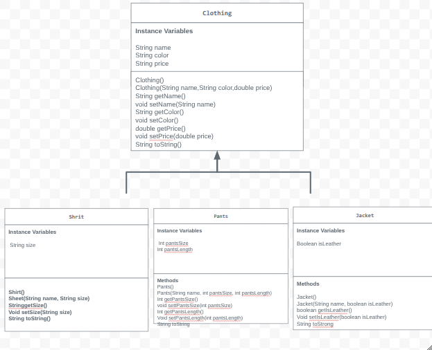

# store-managment-project
# Unit 2 - Store Management Project

## Introduction

You are opening a new business in your community! Businesses often need programs to manage the products and services they offer and track orders and requests from customers. Your goal is to create a store management system for your business.

## Requirements

Use your knowledge of object-oriented programming and class structure and design to create your store management system:
- **Create a class hierarchy** – Develop a superclass that represents a product or service your business offers and one or more subclasses that extend the superclass to represent more specific types of products or services.
- **Declare instance variables** – Declare instance variables in the superclass that are shared with the subclasses and instance variables in the subclasses that are not shared with the superclass.
- **Write constructors** – Write no-argument and parameterized constructors in the superclass and subclasses. Subclass constructors use the super keyword to call the superclass constructor.
- **Implement accessor and mutator methods** – Write accessor and mutator methods for instance variables that should be accessible and/or modifiable from outside of the class.
- **Implement a toString() method** – Write toString() methods in the superclass and subclasses that return information about the state of an object.

## UML Diagram

Embed your UML Diagram here. Upload the image of your UML Diagram to your repo, then use Markdown to insert your image here:

## Description

1. Write a description of your project here. Include what your store you made, and why you chose this topic. In your description, include as many vocab words from our class to explain how you represented the item/service from your store. If you have user input, explain how the user will interact with your store such as which questions are prompted to the user, what response is your program expecting, and how that is used to output information for your store in the console.

- My project is suppposed to represent some type of store. In this case it is a clothing store selling jackets, shirts, and pants. I chose this topic because I really like shopping and I feel we have done lots of code.org lessons with shopping/clothing stores as examples. So my code uses abstraction in order to hide all of the code from the user. All of the items are represented with different instance variables, these are used to follow the attributes of each instance like the name of a clothing item. The parent class is clothing and the subclasses are shirt, pants, and jacket.The subclasses use encapsulation, which is restricted by the access modifiers in each class, specifcally the private acess modiefer. My code uses many different data types using the primative type and reference type to define the variable, attributes, and behaviors. In each class I also use overloading and different signatures. These contribute to the no argument construors in each class as well as the parameterized constructors. So these can still be accessed from outside the class or in the storerunner.java, I had to make an accessor and mutator method, this also helps to update when a user inputs something. 

2. How is this project related to STEAM (Science, Technology, Engineering, Art, and Mathematics)? Provide explicit examples from the project and details as possible. 

- This project is related to STEAM in many ways. For the science elment, I would argue coding is a science to the code as a whole is the science element. For the technology aspect, this is literally being made on a computer. The console and where the user inputs their part is also the technology part. For the engineering, I would say the subclasses extending the superclass. For example the shirt class being an extension of the clothing class. For the art aspect, I would say it is my uml diagram the picture inserted above this descripton part.In this I name my classes and their atrributes and behaviors. For the math part it would be where I used the == or +=. For example when I used it in the Jacket class to decide weather or not the user pays more for leather.

3. What SLOs did you demonstrate during completing this project?

- For my SLOs I demonstarted critial thinkers, I did this when debugging my code at the end to make sure it works correctly or without errors. Creating my classes and uml diagram to see what makes the most sense for every class.I would also say effective commiunicators, when I asked my classmates for help and even just communicating with the teacher about this project and where to find all the resources.
